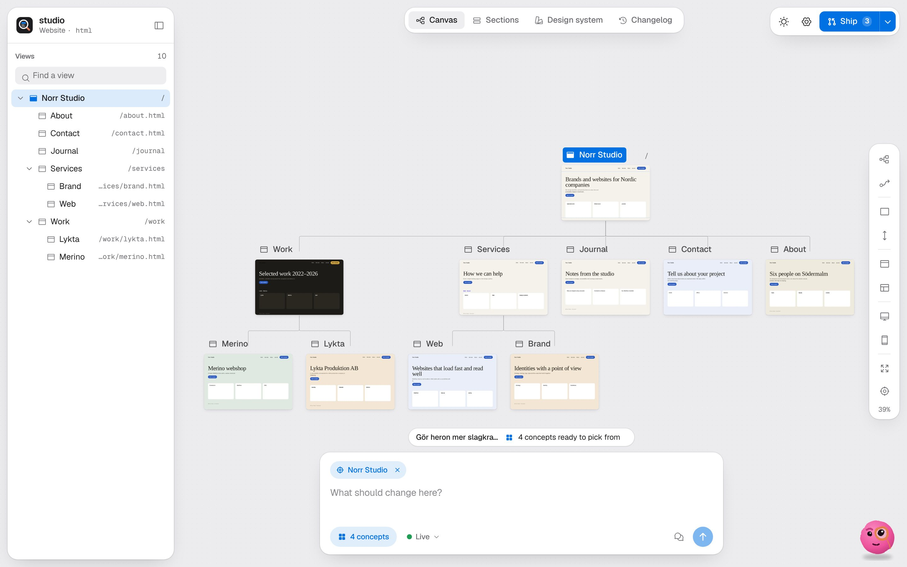
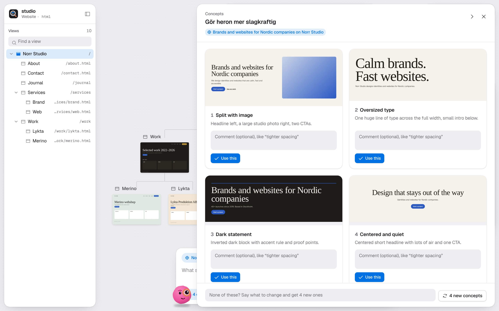
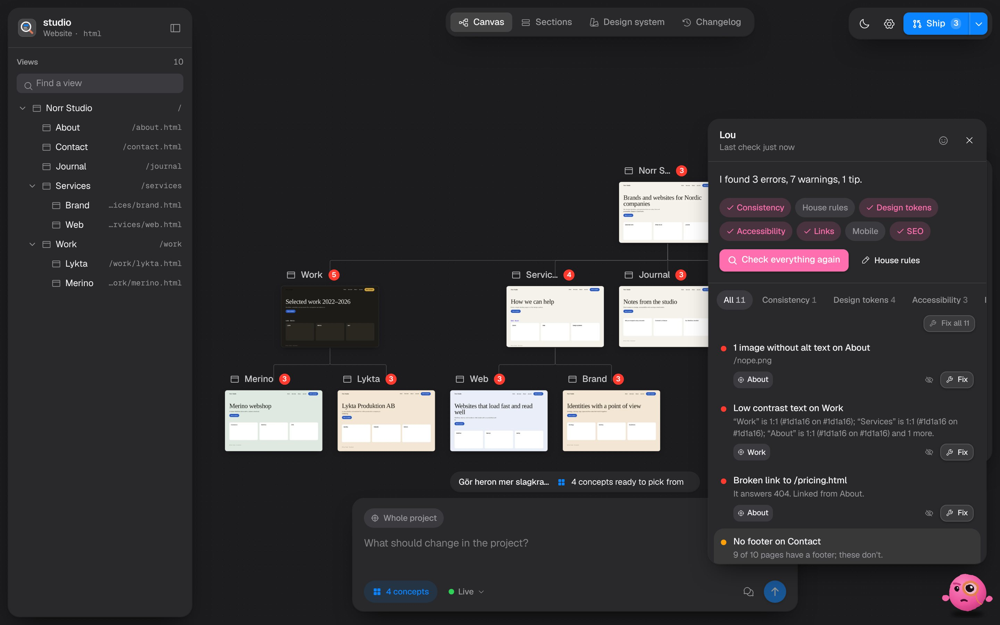

# Loupe

**See your whole project on one canvas, and point Claude Code at exactly the part you want changed.**

Loupe is a Claude Code plugin for designers and developers. It lays out every page or screen of your project as live frames on a canvas next to your terminal. Click a page, a section or a single button, type what should change, and Claude edits only that. A small clay helper named Lou checks the project for inconsistencies, broken links and accessibility problems, and hands the fixes to Claude.



## What you can do

- **See every view at once.** Websites appear as a sitemap (a tree by URL), products as a flow (screens connected by the navigation found in the code). Frames are real snapshots, in Screen or Full page height, Live or Wireframe, Desktop or Mobile. Double-click a frame to use the live page.
- **Point, then prompt.** Select a view, a section (hero, features, footer …) or individual elements, and your next prompt only touches that. Prompt from the bar at the bottom of the canvas, or in Claude Code as usual. Loupe adds the scope either way.
- **Pick from 4 concepts.** With **4 concepts** on, a design request opens a drawer where Claude sketches four directions, previewed on the real page. Comment on the one you like and pick it, and Claude builds it. Not quite right? Ask for four new ones.
- **Let Lou check your work.** Click Lou in the corner to check the whole project, or drag him onto one page to check just that page. He reports pages that break their siblings' layout, your house rules, off-token colors and fonts, accessibility, broken links, mobile and SEO. Every finding has a **Fix** button that sends it to Claude, and **Fix all** sends them in one go. Ignore what doesn't matter to you, and he remembers. He also tells (bad) jokes.
- **Know what changed.** The **Changelog** tab logs every change Claude makes with the request, the scope, Claude's summary and the files it touched. Export it as Markdown.
- **See your design system.** Tokens, primitives and components, and which views use each. Select a component to scope prompts to it.
- **Ship it.** Commit, push or open a pull request from the top bar, with a commit message Claude can draft from the diff.





Light, dark or system theme. Press **?** in the canvas for keyboard shortcuts.

## Install

You need Claude Code and Node 20+. Run this in a terminal, or ask Claude to run it in a Code tab session in the desktop app:

```bash
claude plugin marketplace add ellioteeriksson/loupe && claude plugin install loupe@loupe
```

Start a new session, open a project and type `/loupe`. [INSTALL.md](INSTALL.md) has the details and troubleshooting.

**Updates:**

```bash
claude plugin marketplace update loupe && claude plugin update loupe@loupe
```

## Use it on an existing project

```text
cd your-project
npm run dev            # in another terminal; frames load from the dev server
claude
> /loupe
```

The first time, Claude reads what was detected, checks whether the project is a website or a product, names the views and labels the main flow. The canvas opens at `http://localhost:4777`.

| What you do | What happens |
| --- | --- |
| Click a frame or a row in the list | Your prompts are scoped to that view (highlighted in blue). Esc or click the background to clear it. |
| Then click a section inside it | Your prompts are scoped to just that section (hero, features, footer …). Hover shows the section names. Esc steps back to the page. |
| Double-click a frame, or hover and click **Interact** | Use the live page inside the canvas. Esc exits. |
| Hover a frame → **Select elements** | Pick buttons, text, images or blocks. Click selects, Shift-click adds, ↑ ↓ parent/child, Esc finishes. Prompts then only affect those elements. |
| Screen / Full page, Live / Wireframe | Change the frame height or layer (toolbar on the right edge of the canvas). |
| ☾ in the top bar | Light, dark, or match system. |
| Double-click a name | Rename the view. |
| ⤢ / Shift+1 (canvas toolbar) | Zoom out to show the whole project. |
| ⌖ / Shift+2 (canvas toolbar) | Zoom in on the view closest to the centre of the screen. |
| Sitemap / Flow, Desktop / Mobile | Switch the layout or the frame size (same toolbar). |
| Drag frames | Your layout is saved. Use Settings → Reset layout to undo it. |
| Prompt bar / ⌘K | Send a prompt to the Claude Code chat open in this project. It's scoped to what's selected. Click the speech bubble to see earlier prompts and Claude's answers. |
| Ship ▾ | Commit, commit & push, or commit + push + open a PR. If you're on `main`, it creates a branch first. **Write with Claude** drafts the commit message from the diff. |
| Click Lou, or press L | Open Lou. **Check the project** checks every page; **Check {page} only** checks the selected page. |
| Drag Lou onto a frame | Check just that page. The frame lights up while you hover it. |
| Settings → Show Lou | Hide or show Lou. |
| ? | Keyboard shortcuts. |

### Commands

- `/loupe`: open the canvas, or reopen it if it's already running
- `/loupe-listen`: let this chat take prompts from the canvas prompt bar right away (see below)
- `/loupe-stop`: stop the server
- `/loupe-preview`: add a dev-only `/__canvas` route so the Design system tab shows live component previews

### How scoping works

| Hook | What it does |
| --- | --- |
| `UserPromptSubmit` | Adds a `<loupe-scope>` note to each prompt: the selected view, its route, files that belong only to it, files shared with other views, and its preview URL. |
| `PreToolUse` (Edit/Write) | Asks you before Claude edits a file outside the selection. Set `"scopeGuard": "off"` in `.canvas/config.json` to turn this off. |
| `SessionStart` | Tells Claude where the plugin lives and whether a canvas is open. |
| `Stop`, `UserPromptSubmit` | Hand over prompts sent from the canvas while Claude was busy or the chat was idle. |

When no canvas is running, the hooks do nothing.

### Prompting from the canvas

Every Claude Code chat with the plugin connects itself to the project's canvas, and shows up in the prompt bar's chat picker (labelled with the last thing you asked it). A prompt sent from the canvas reaches that chat by the first route that works:

| Chat state | How the prompt gets there |
| --- | --- |
| **Live** (started with channels, see below) | Straight into the chat, even when it's idle. Permission prompts also show up in the canvas, with Allow and Deny. |
| **Listening** (starts with `/loupe`, or `/loupe-listen`) | Claude waits for canvas prompts and picks them up right away. Works in the desktop app. Interrupt Claude to type in the chat; it goes back to listening when it's done. Say "stop listening", or use the chat menu in the prompt bar, to end it. |
| **Working** | Claude takes it as soon as it finishes what it's doing. |
| **Idle** | It rides along with the next message you type in the chat. |

Claude answers in the canvas with a short summary of what it changed, and the prompt shows what Claude is doing while it works.

**Live mode** uses Claude Code [channels](https://code.claude.com/docs/en/channels), a research preview that needs Claude Code 2.1.80+ and a claude.ai or Console login (Team and Enterprise admins must turn channels on). Custom channels aren't on Anthropic's allowlist yet, so start the terminal session with the development flag:

```bash
claude --dangerously-load-development-channels plugin:loupe@loupe
```

Claude Code asks you to confirm once at startup. In the desktop app, use `/loupe-listen` instead.

### Lou's checks

| Check | What Lou looks for |
| --- | --- |
| Consistency | Pages missing the header or footer the others have, different fonts, headline sizes or content widths, subpages that break their siblings' layout |
| House rules | Your own rules in `.canvas/rules.md` (edit them from Lou's panel). Claude checks these, so a chat must be connected |
| Design tokens | Colors and fonts that aren't in your design system, too many text sizes |
| Accessibility | Missing alt text, low contrast, buttons and links without a name, form fields without labels, headings that skip levels, missing page language |
| Links | Links that answer 404 or don't load, and placeholder `#` links |
| Mobile | Pages that scroll sideways, text that's too small, a missing viewport tag |
| SEO | Page titles, meta descriptions, share images, duplicate titles |

The same problem on many pages is grouped into one finding. Lou only runs when you ask him to.

## Supported projects

| Framework | Detected from |
| --- | --- |
| Next.js | `app/**/page.*` (App Router) and `pages/**` |
| Vite + React Router | `createBrowserRouter`, `<Route>`, `app/routes.ts` (v7) and flat `app/routes/*` |
| TanStack Router | `createFileRoute()` |
| Astro | `src/pages/**` |
| Plain HTML | every `*.html`, served by the canvas itself |

If something is missed, add it in `.canvas/config.json` (`views`, `framework`, `devUrl`, `params` for dynamic routes). The skill documents every key. Commit `config.json`. `state.json` and `manifest.json` are gitignored automatically.

## Privacy

Loupe runs entirely on your machine. The canvas server listens on `127.0.0.1` only and refuses requests from other sites. Nothing is sent anywhere except through your own Claude Code session.

## Developing the UI

```bash
cd app && npm install
node ../server/index.mjs --project /path/to/project   # API on :4777
npm run dev                                            # UI with hot reload, proxies /api
npm run build                                          # writes app/dist (commit it)
```

## License

MIT. See [LICENSE](LICENSE).
